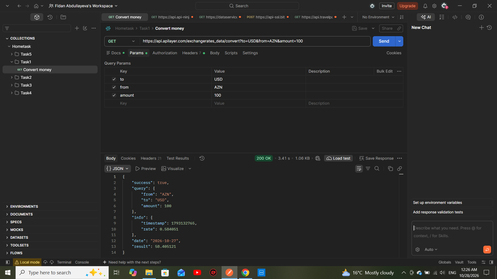

Task 1: Convert Money

Objective
To convert an amount from one currency to another using an existing currency conversion API.

API Request
- HTTP Method: GET
- From Currency: AZN
- To Currency: USD
- Amount: 100

cURL Request
curl --location 'https://api.apilayer.com/exchangerates_data/convert?to=USD&from=AZN&amount=100' \
--header 'apikey: MY_API_KEY'

Response
The API returned a successful response with the converted amount.
- Status Code: 200 OK

See the screenshot below for the actual API response.

Tools Used
- Postman
- Exchange Rates Data API
## Screenshot

