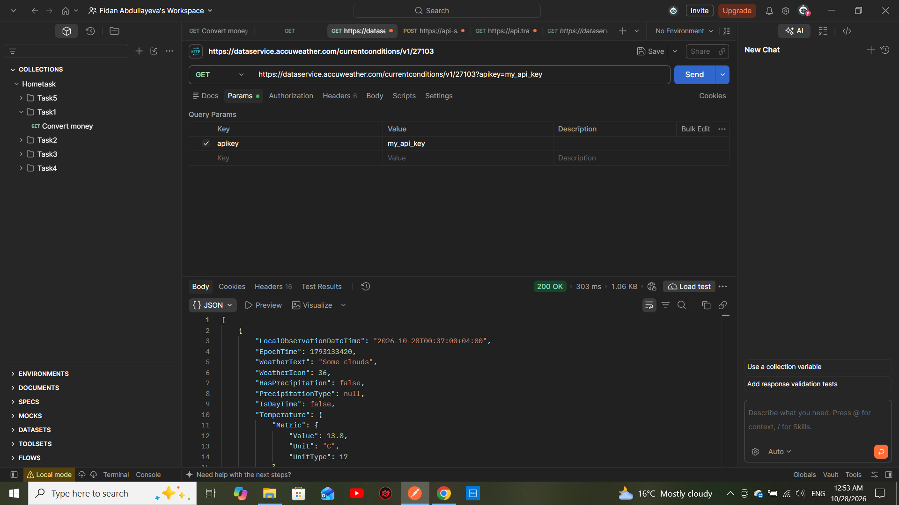

Task 3: Weather Forecast

Objective
To retrieve current weather conditions using an existing weather API.

API Request
- HTTP Method: GET
- Endpoint: "https://dataservice.accuweather.com/currentconditions/v1/27103"
- Path Parameter: "27103" — Location Key
- Query Parameter: "apikey"
- Status Code: 200 OK

cURL Request
curl --location 'https://dataservice.accuweather.com/currentconditions/v1/27103?apikey=MY_API_KEY'

Response
The API returned a successful response containing current weather conditions for the specified location.
- Status Code: 200 OK

Tools Used
- Postman
- AccuWeather API

## Screenshot

