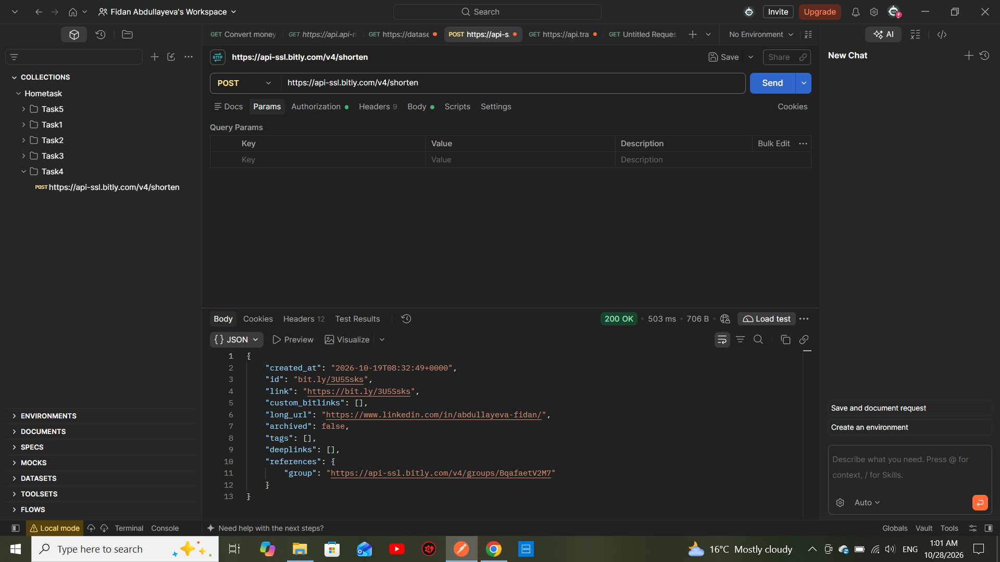

Task 4: Shorten the Link

Objective
To shorten a long URL using an existing URL shortening API.

API Request
- HTTP Method: POST
- Endpoint: "https://api-ssl.bitly.com/v4/shorten"
- Content-Type: "application/json"
- Authorization: Bearer Token

cURL Request
curl --location 'https://api-ssl.bitly.com/v4/shorten' \
--header 'Content-Type: application/json' \
--header 'Authorization: Bearer MY_ACCESS_TOKEN' \
--data '{
  "long_url": "https://www.linkedin.com/in/abdullayeva-fidan/"
}'

Request Body
{
  "long_url": "https://www.linkedin.com/in/abdullayeva-fidan/"
}

Response
The API returned a successful response containing the shortened URL.
- Status Code: 200 OK

Tools Used
- Postman
- Bitly API

## Screenshot

