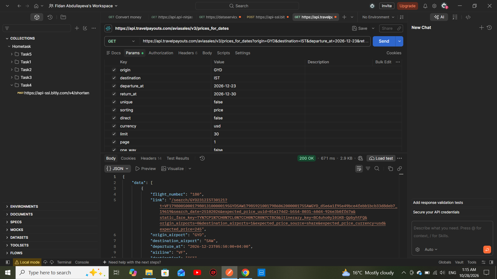

Task 5: Get the Cheapest Ticket

Objective
To retrieve flight ticket prices for a specified route and travel dates using an existing flight search API.

API Request
- HTTP Method: GET
- Endpoint: "https://api.travelpayouts.com/aviasales/v3/prices_for_dates"
- Origin: GYD (Baku)
- Destination: IST (Istanbul)
- Departure Date: 2026-12-23
- Return Date: 2026-12-30
- Sorting: Price
- Currency: USD
- Status Code: 200 OK

cURL Request
curl --location 'https://api.travelpayouts.com/aviasales/v3/prices_for_dates?origin=GYD&destination=IST&departure_at=2026-12-23&return_at=2026-12-30&unique=false&sorting=price&direct=false&currency=usd&limit=30&page=1&one_way=false&token=MY_API_TOKEN'

Response
The API returned a successful response containing flight price information for the specified route and travel dates.
- Status Code: 200 OK

Tools Used
- Postman
- Travelpayouts Aviasales API

## Screenshot

